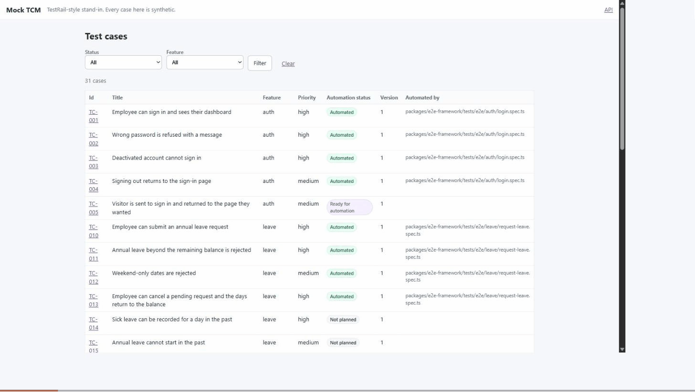
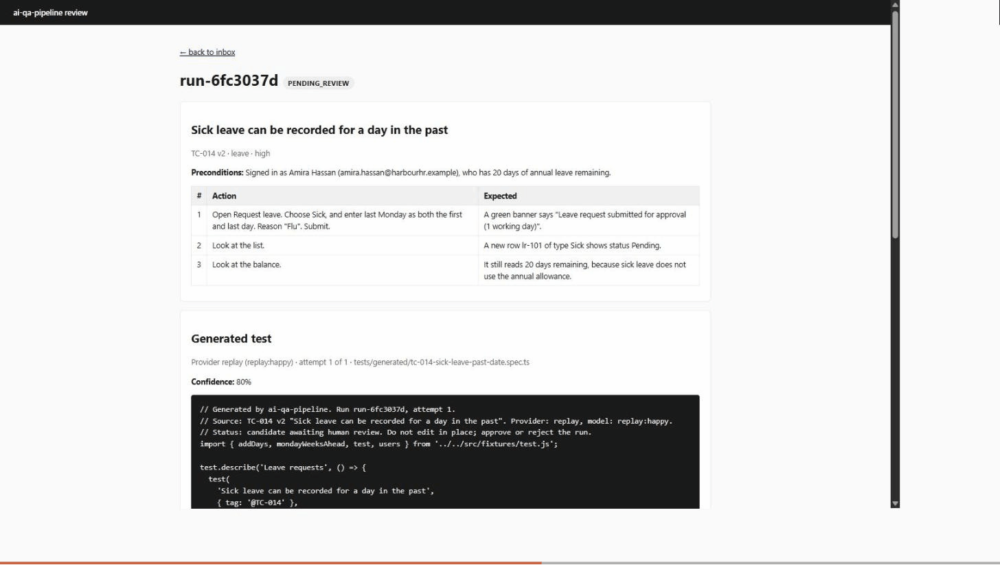
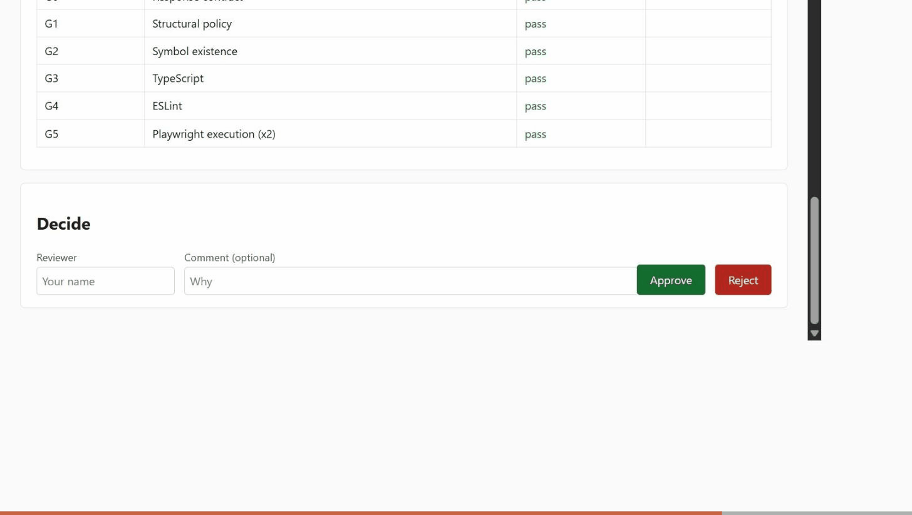
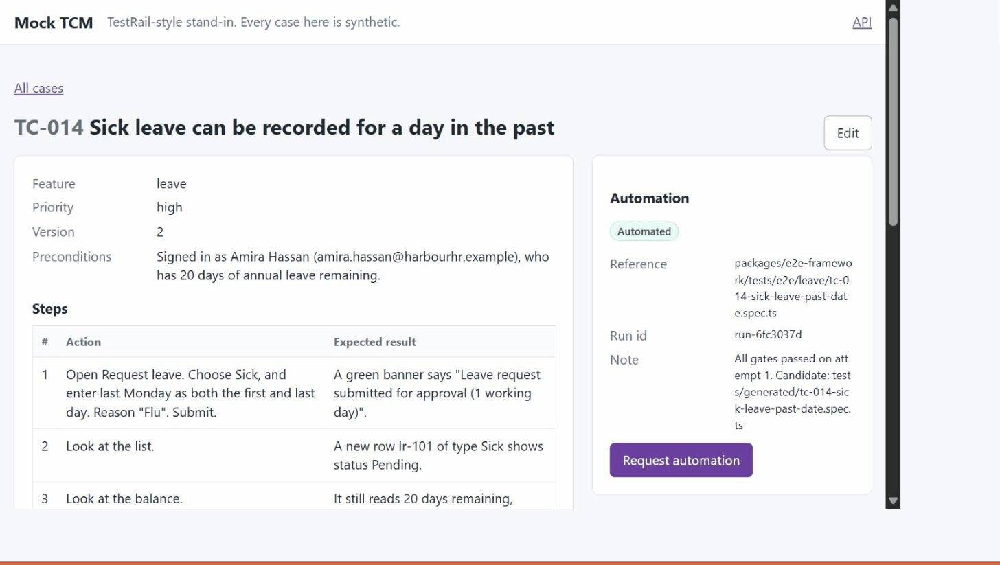
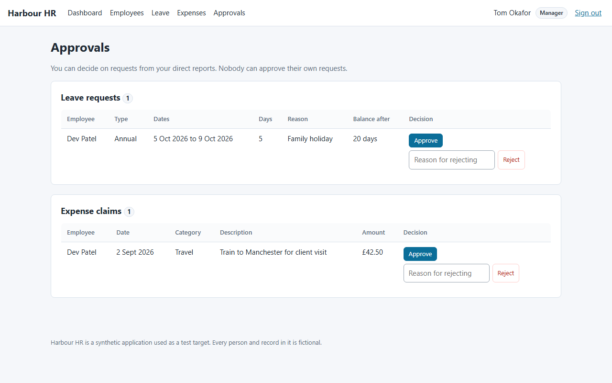
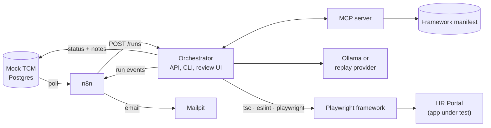

# agentic-qa-tcm

**Turns manual test cases into Playwright tests with a local AI model, strict automated checks and human sign-off.**

<p align="center">TypeScript · Node 24 · Playwright · n8n · Ollama · prototype · private · <a href="#run-it-locally">Run it locally</a></p>

<p align="center">
  <a href="https://github.com/latczar/agentic-qa-tcm/actions/workflows/ci.yml"></a>
</p>

<p align="center">
  
  
  
  
  
</p>

## Why it exists

Asking a model to "write a test" gives you code that looks right but often calls methods that do not exist, or passes without checking anything. This project treats the model as one replaceable part of an ordinary, testable pipeline. A generated test is only accepted if it passes a series of deterministic checks and runs for real, and even then a person approves it before it joins the suite.

## What it does

- **Picks up cases marked Ready for Automation.** n8n polls a TestRail-style mock TCM every two minutes and hands new cases to the orchestrator, with no manual step.
- **Builds context from the real framework.** An MCP server answers questions about the Playwright framework's page objects and fixtures from a committed manifest, extracted with ts-morph. Retrieval is a lookup table and keyword overlap, not embeddings.
- **Checks every candidate with up to seven gates.** G0 response schema, G1 framework structure, G2 symbol existence, G3 `tsc`, G4 ESLint, G5 two real Playwright runs (to catch flakiness), and G6, which deliberately breaks the feature under test and requires the test to notice. G6 covers leave submission only.
- **Retries with specific feedback.** A failed gate sends its findings back to the model (up to three attempts by default). Flaky or exhausted runs stop at `NEEDS_ATTENTION`; an unreachable model defers the run without spending an attempt.
- **Waits for a human.** Every candidate that passes lands in a review inbox and n8n emails the reviewer through Mailpit. Approving moves the file into the real suite and sets the case to `Automated` in the TCM.
- **Proves itself without a model.** A replay provider returns canned responses, so 13 failure scenarios under `scenarios/` run the whole pipeline (Postgres, `tsc`, ESLint, Playwright) with no LLM installed.

## How it fits together



The orchestrator is the core: a run state machine stored in Postgres that builds context, calls the model, runs the gates and parks results for review. n8n is only scheduling and notification glue. The mock TCM and the HR Portal are hand-built stand-ins, and every person and record in them is fictional. The full design is in [docs/ARCHITECTURE.md](docs/ARCHITECTURE.md).

## Run it locally

1. **Prerequisites:** Node 24 (see `.nvmrc`; `package.json` allows 22 or newer) and Docker with Compose v2 (Docker Desktop with WSL 2 on Windows). [Ollama](https://ollama.com) is optional and only needed for a real model.
2. **Environment (optional):** `cp .env.example .env`. Nothing is required; every value has a local default. You can override `POSTGRES_USER`, `POSTGRES_PASSWORD`, `POSTGRES_DB`, `POSTGRES_PORT`, `N8N_PORT`, `MAILPIT_SMTP_PORT`, `MAILPIT_UI_PORT`, and for the orchestrator `LLM_PROVIDER`, `LLM_MODEL`, `OLLAMA_URL`, `AGENT_MODE`, `LLM_TIMEOUT_MS`, `EVENTS_WEBHOOK_URL` and `PUBLIC_URL`.
3. **Install:** `npm ci`, then `npx playwright install chromium` if you have no Playwright browsers yet.
4. **Start the services:**

   ```bash
   docker compose up -d          # Postgres, n8n, Mailpit
   npm run dev -w apps/mock-tcm  # http://localhost:4000
   npm run dev -w apps/hr-portal # http://localhost:3000
   EVENTS_WEBHOOK_URL=http://localhost:5678/webhook/run-events \
   LLM_PROVIDER=replay LLM_SCENARIO=happy \
   npm run dev -w packages/orchestrator  # http://localhost:5000
   ```

5. **Try it:** open http://localhost:4000/cases and mark a case Ready for Automation. Within about two minutes n8n dispatches it, the run reaches `PENDING_REVIEW`, and an email arrives in Mailpit (http://localhost:8025). Approve or reject it at http://localhost:5000/review. A recording of this loop is in [docs/media/demo.gif](docs/media/demo.gif).

To use a real model, run `ollama pull qwen2.5-coder:7b` and set `LLM_PROVIDER=ollama`. Read [Status and limits](#status-and-limits) first.

**Tests:**

```bash
npm run lint
npm run typecheck
npm test                  # unit tests (Vitest)
npm run test:e2e          # Playwright suite against the HR Portal
npm run test:integration  # needs Postgres: the scenario matrix and TCM repository tests
npm run manifest:check    # the committed framework manifest matches the code
npm run format:check
```

## Where things are

| Folder                        | What lives there                                                                         |
| ----------------------------- | ---------------------------------------------------------------------------------------- |
| `apps/hr-portal`              | Harbour HR, the synthetic app under test (Express, in-memory seed data)                  |
| `apps/mock-tcm`               | TestRail-style test case manager: REST API, small UI, Postgres                           |
| `packages/orchestrator`       | The pipeline: run state machine, context builder, gates G0 to G6, review UI and API, CLI |
| `packages/mcp-server`         | MCP tools that expose framework context to the model                                     |
| `packages/framework-manifest` | Builds and drift-checks the manifest of page objects and fixtures                        |
| `packages/e2e-framework`      | The Playwright framework: pages, fixtures, tests, custom ESLint rules                    |
| `packages/shared`             | Shared types                                                                             |
| `scenarios`                   | 13 replay fixtures, each a deliberate failure run as a real integration test             |
| `prompts`                     | Versioned prompt templates (`v1`, `v2`)                                                  |
| `n8n/import`                  | Workflows and the Mailpit credential, imported on `docker compose up`                    |
| `docker`                      | Container init scripts                                                                   |
| `docs`                        | Architecture, decision records, results, talking points                                  |

## Status and limits

A working prototype, built in tagged phases (see [CHANGELOG.md](CHANGELOG.md)).

- **The free local model rarely passes from scratch.** Against `qwen2.5-coder:7b`, 0 of 8 runs reached review. Every attempt was stopped by a correct gate, and two bugs in the pipeline's own hint logic were found and fixed along the way. Details in [docs/results.md](docs/results.md).
- **G6 covers one feature.** Only leave submission has a sabotage switch. Tests for other features could still check only the surface response.
- **Retrieval is rule-based.** Fine for one small framework; it would need rework for a much larger codebase.
- **Only Postgres, n8n and Mailpit run in Compose.** The two apps and the orchestrator run on the host.
- **No authentication.** One reviewer, no user accounts in the review UI or n8n. Local use only.

## Docs

| I want to...                           | Read                                             |
| -------------------------------------- | ------------------------------------------------ |
| Understand the full design             | [docs/ARCHITECTURE.md](docs/ARCHITECTURE.md)     |
| See why each contested choice was made | [docs/adr](docs/adr)                             |
| See how a real local model performed   | [docs/results.md](docs/results.md)               |
| Read what was learnt while building it | [docs/talking-points.md](docs/talking-points.md) |
| See what changed in each phase         | [CHANGELOG.md](CHANGELOG.md)                     |

## How this was built

Written with AI assistance (Anthropic's Claude), directed and tested by Lattrell Caesar.

## More from latczar

| Project                                                                 | What it is                                                                |
| ----------------------------------------------------------------------- | ------------------------------------------------------------------------- |
| [agentic-qa-sd](https://github.com/latczar/agentic-qa-sd)               | Local AI service desk with a human approval gate.                         |
| [automation-architect](https://github.com/latczar/automation-architect) | Maps a manual process and flags which steps are safe to automate.         |
| [doctor-outreach-demo](https://github.com/latczar/doctor-outreach-demo) | Doctor outreach pipeline with AI drafts and human approval.               |
| [dturbanada-booking](https://github.com/latczar/dturbanada-booking)     | Coach seat booking, QR tickets and staff tools for a Philippine operator. |
| [mintern](https://github.com/latczar/mintern)                           | AI marketing strategist that drafts posts and waits for your yes.         |
| [remote-jobs-mvp](https://github.com/latczar/remote-jobs-mvp)           | Remote job board showing which countries can apply, with proof.           |

## Licence

Private. All rights reserved.
